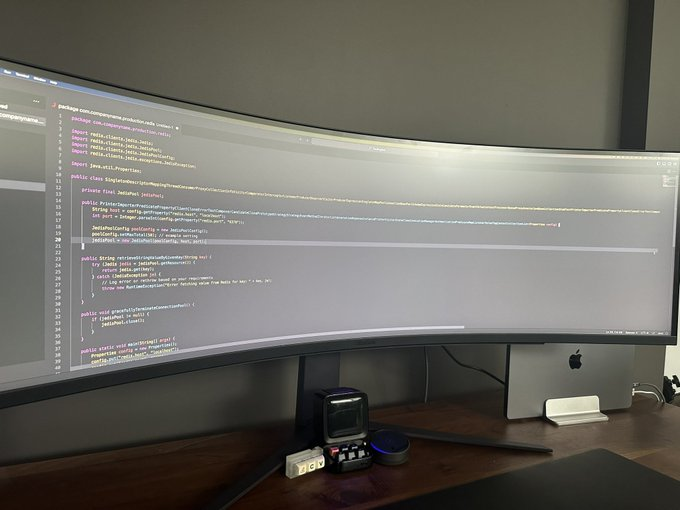

# Лабораторная работа № 5. Stream API, Gson и Lombok

**Автор:** ФИО: ___ (укажите ваши ФИО), группа: ___ (укажите группу)

## Описание




Решение лабораторной работы по теме «Stream API, Gson и Lombok». Программа читает список посетителей библиотеки из `src/main/resources/books.json` с помощью **Gson**, классы моделей (`Book`, `Visitor`, `SmsMessage`) сгенерированы с помощью **Lombok**, все шесть заданий по обработке данных выполнены через **Stream API**:

1. Список посетителей и их количество.
2. Все книги избранных списков без повторений и их количество.
3. Сортировка всех книг по году издания.
4. Проверка наличия произведений автора «Jane Austen».
5. Максимальное число избранных книг у одного посетителя.
6. Группировка подписчиков (`subscribed = true`) относительно среднего числа книг по всем посетителям и генерация SMS-сообщений (`you are a bookworm` / `read more` / `fine`).

## Требования

- JDK 25 LTS (или новее)
- Apache Maven 3.9+

## Сборка

```bash
mvn compile
```

## Запуск

```bash
mvn exec:java
```

Либо запустите класс `org.example.Main` из вашей IDE.

## Структура проекта

```
src/main/java/org/example/
├── Main.java                  # точка входа, все 6 заданий через Stream API
└── library/
    ├── Book.java              # книга (Lombok @Data)
    ├── Visitor.java           # посетитель библиотеки (Lombok @Data)
    └── SmsMessage.java        # SMS-сообщение (Lombok @Data)
src/main/resources/
└── books.json                 # исходные данные (15 посетителей)
```

## Используемые библиотеки

- [Gson 2.15.0](https://github.com/google/gson) — чтение JSON
- [Lombok 1.18.48](https://projectlombok.org/) — генерация геттеров, сеттеров, `toString()`, `equals()`, `hashCode()`
